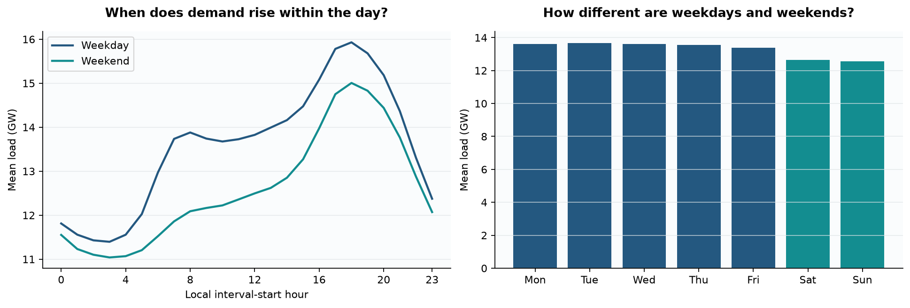
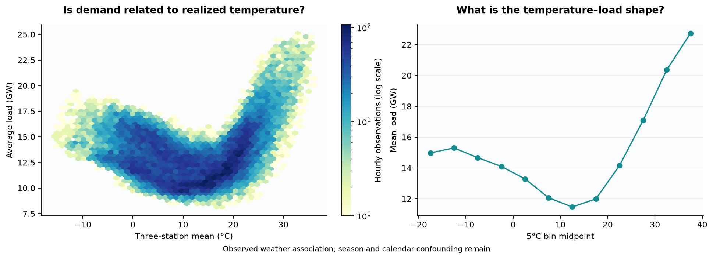
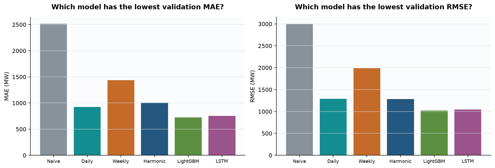
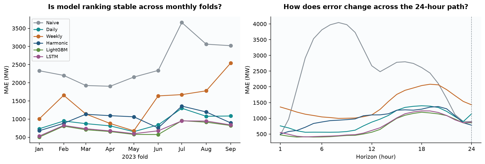
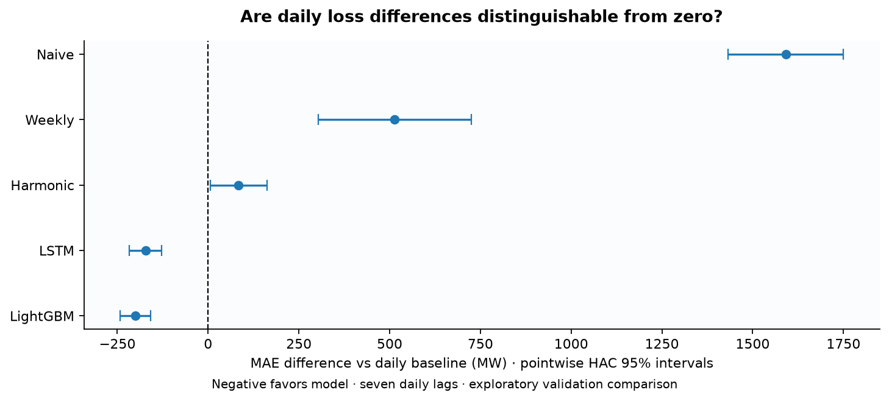
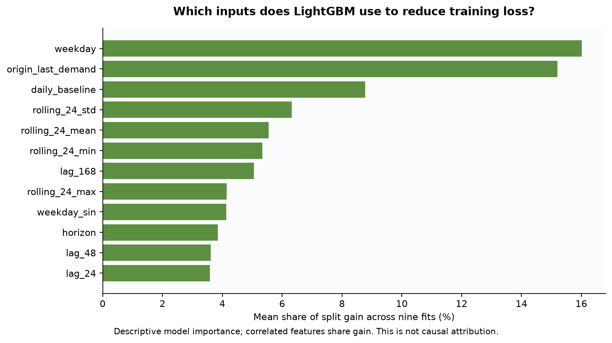
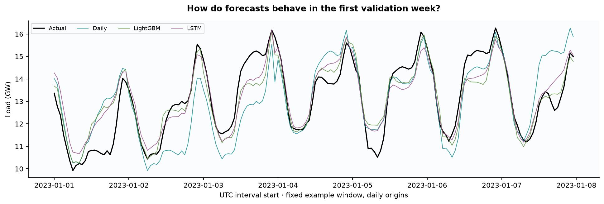
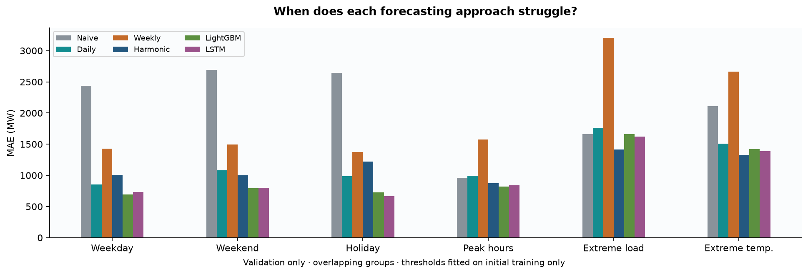

# GridCast
### Electricity Demand Forecasting Under Uncertainty

## Question

**How accurately can short-term electricity demand be forecast, how uncertain are those forecasts,
and when do sophisticated models actually outperform strong seasonal baselines?**
A secondary question asks whether residuals identify unusual demand behavior.

**Milestones 1–3 complete: data, EDA, backtesting and six-model validation comparison.**
Calibration and final-test outcomes remain unscored. This is a data science project focused on temporal evaluation, uncertainty
and honest comparison.

## Dataset

Selected: **EIA-930, New England balancing authority (ISNE), reported hourly Demand, 2020–2024**.
The original operator reports to the federal statistical provider; no third-party mirror is used.
EIA offers a credential-free workbook with explicit UTC timestamps, reported/adjusted/imputed fields
and a usable five-year history. [Download](https://www.eia.gov/electricity/gridmonitor/knownissues/xls/ISNE.xlsx),
[Grid Monitor](https://www.eia.gov/electricity/gridmonitor/dashboard/electric_overview/US48/US48).

Three candidates were investigated:

| Candidate | Verified scope, target and clock | Access, missingness and weather | Decision |
|---|---|---|---|
| EIA-930 / ISNE | New England; hourly demand; workbook units MWh; hour-ending UTC plus Eastern local metadata. Original EIA series begin July 2015; this study uses 2020–2024. | Workbook downloaded without credentials. Study has no missing/duplicate UTC intervals, missing demand, nonpositive demand or imputed demand. NOAA airports can be aligned in UTC. | **Selected:** explicit time axis and reproducible public access. |
| ISO New England SMD archive | New England/control area and eight zones; hourly `System_Load` and `RT_Demand` in MW; local hour-ending labels. Archive listing includes 2016–2026, with current year partial. | Annual public workbooks, with observed dry-bulb/dew-point weather in °F. Template notes explicitly synthesize the spring hour and average repeated autumn hours. Other missingness not measured because rejected before full ingestion. | Useful provider data, but DST preprocessing loses real-hour information needed here. |
| PJM Data Miner, metered load | PJM load areas; hourly MW; both interval-beginning UTC and Eastern Prevailing Time. Public feed inspected; historical earliest bound not independently verified. | Public UI; automated queries require an account. Provider restricts redistribution without membership. Missingness not measured. NOAA alignment is feasible, but the large footprint needs spatial weighting. | Not selected for an account-free, publicly reproducible portfolio. |

Sources: [EIA history/access](https://www.eia.gov/todayinenergy/detail.php?id=40993),
[ISO-NE archive](https://www.iso-ne.com/isoexpress/web/reports/pricing/-/tree/zone-info),
[ISO-NE template, Notes sheet](https://www.iso-ne.com/static-assets/documents/2016/08/smd_hourly_template_v0.xlsx),
[PJM feed](https://dataminer2.pjm.com/feed/hrl_load_metered),
[PJM access/redistribution terms](https://www.pjm.com/markets-and-operations/etools/data-miner-2).
Unverified candidates are not described as complete or gap-free.

**Study dimensions:** 43,848 hourly rows, 34 processed columns, plus the UTC index.
Interval starts span `2020-01-01 00:00Z` through `2024-12-31 23:00Z`.
The full downloaded workbook has 98,856 hourly rows; selection of the study window is logged.
These counts come from [data_quality.json](reports/data_quality.json).

**Target and provenance.** The workbook's Notes sheet labels `Demand` as MWh.
For each one-hour interval, energy divided by one hour gives average demand in **MW**;
`demand_mwh_reported` preserves the source, and `demand_mw` is the target.
Adjusted/imputed columns are retained for auditing, never silently substituted.
Workbook definitions are extracted into [source_definitions.json](reports/source_definitions.json).
All raw files are read-only, unmodified snapshots. [sources.lock.json](configs/sources.lock.json)
records URL, retrieval timestamp, size, SHA-256 and available HTTP metadata.

**Time handling.** EIA's UTC hour ending is shifted back exactly one elapsed hour to the interval
start; local calendar features use `America/New_York`. The local hour-end metadata is cross-checked.
There are zero unexpected UTC duplicates/gaps. All five 23-hour spring days and five 25-hour autumn
days are preserved, along with 48 UTC leap-day hours. The five repeated local hours are distinct
UTC observations. UTC year boundaries leave partial local days at the two study edges; these are
reported, not padded. No timezone-naive joins, DST averaging, invented hours or dropped leap days.

**Weather.** NOAA NCEI ISD observations from Boston Logan (`72509014739`), Hartford Bradley
(`72508014740`) and Providence/T. F. Green (`72507014765`) are downloaded from the
[NOAA NODD archive](https://noaa-global-hourly-pds.s3.amazonaws.com/index.html).
NOAA [documents the archive transition](https://www.nesdis.noaa.gov/news/service-location-change-integrated-surface-data-global-hourly);
ISD is suitable for this historical 2020–2024 study, but is no longer updated beyond August 2025.

We decode temperature/dew point from tenths °C, accept QC codes 0/1/4/5 and instantaneous
FM-15/FM-16 reports, and retain exclusions/flags with source row lineage in interim Parquet files.
Simultaneous reports are reduced by median, then observations are averaged within each UTC hour.
The equal-weight three-station mean requires all three stations: **149 temperature hours and
226 dew-point hours remain missing**, with no interpolation. This southern New England proxy is
not a population-weighted regional temperature. Station IDs/coordinates and documented names
are checked; metadata renames do not silently change stations. [NOAA format/QC definitions](https://www.ncei.noaa.gov/pub/data/noaa/isd-format-document.pdf).

## Forecasting Setup

**Primary task: forecast the next 24 hourly values**, issued daily at 00:00 UTC.
Horizon `h=1..24` targets average demand during `[origin+h−1h, origin+h)`.
This is a 24-hour path, not 24 separate one-step forecasts with actuals revealed inside the path.
The final horizon is 24 hours ahead.

We assume one hour of reporting delay: usable demand must have `interval_end <= origin−1h`.
Weather hour means have the same assumed delay. Publication timestamps are not observed;
this is an explicit availability approximation. EIA's current reporting instructions allow
submission within 60 minutes of hour end. [EIA-930 instructions](https://www.eia.gov/survey/form/eia_930/instructions.pdf).

## Preventing Leakage

- Training, validation, calibration and test are separate Parquet files. EDA reads **only training**.
  The final test receives schema/time/QC checks, not distributional exploration or model selection.
- The availability helper excludes the latest unpublished hour. Lag features must be evaluated
  relative to the forecast origin, not just shifted against the target. Future calendar features
  are known; future demand, weather, market prices and adjusted load are not feature inputs.
- NOAA weather is **observed**, not an archived forecast. The primary experiment excludes future
  observed weather. A future experiment using it must be labeled **conditional on realized weather**.
- Initial-training percentiles define extreme demand/weather. Scalers, imputers and model fitting
  must use each fold's available training history. No target imputation for scoring.
- STL uses two-sided smoothing solely for descriptive plots; its output must never become a feature.
- Latest-revised EIA and NOAA snapshots are not historical publication vintages. Even with a delay,
  this remains a retrospective study, not a verified operational simulation.

Tests mutate future demand/weather to confirm unchanged training summaries, thresholds and
available history; test weather cannot alter an earlier aggregation interval.

## Demand Patterns

<!-- BEGIN EDA FINDINGS -->
Training-only findings (26,304 hours; 2020–2022):

- Mean demand is **13,292.8 MW**; annual means are 2020: 13,160.7 MW, 2021: 13,370.1 MW, 2022: 13,347.9 MW.
  This short record includes pandemic years; the change is descriptive, not a structural trend claim.
- The average local daily profile peaks at **18:00** and reaches its
  minimum at **03:00**. **August**
  has the highest average load. Weekend mean load is **7.2%** below weekdays.
- Autocorrelation is **0.874 at 24 hours** and **0.718 at 168 hours**.
  Daily/weekly baselines are therefore substantive competitors, not token comparisons.
- Extreme demand is fixed at the training 95th percentile: **17,971.4 MW**.
  The training maximum is **25,101 MW** at **2021-06-29 21:00:00+00:00** (interval start).
- The three-station temperature proxy is present for **26,234 training hours**;
  **70** remain missing. Training temperature 5th/95th percentiles are
  **-3.70°C / 27.07°C**.
  Weather associations are observational and confounded by season and calendar.

Source: [eda_summary.json](reports/eda_summary.json). No validation, calibration or test outcomes
contribute to these findings or thresholds.
<!-- END EDA FINDINGS -->




The temperature relationship is U-shaped in the training data: load is lowest in mild conditions
and higher during cold and especially hot conditions. This motivates nonlinear weather covariates,
but does not establish a causal effect. The remaining plots cover the full training history,
month/hour structure, annual cycle, autocorrelation, descriptive weekly decomposition, holiday
comparisons, training extreme episodes and the evaluation timeline. Each title states its question.

## Models

Implemented: persistence, daily and weekly seasonal naive, and **dynamic harmonic regression
with AR(1) errors**. Persistence repeats the last available demand. The statistical model uses
three Fourier harmonics each for daily, weekly and annual cycles, a linear trend, weekend and
holiday indicators, and daily-by-weekend interactions. Calendar features use Eastern local time;
the AR process advances in elapsed UTC hours. There are no weather predictors.

Coefficients and AR(1) correlation are estimated jointly by iterative feasible GLS, with a
50-iteration cap and relative tolerance 1e-6. All nine fits converge. Coefficients refit monthly;
the residual state updates at each daily origin using the latest available observation.
The reporting delay makes forecast residual propagation steps **2–25**, not 1–24.
Orders were fixed before this run; there is no hyperparameter search in Milestone 2.
Fit coefficients, convergence and training endpoints are saved in `reports/statistical_fits.json`.

Under the one-hour delay, daily seasonal naive uses `target_end−24h` for horizons 1–23 and
`target_end−48h` for horizon 24; the previous-day value for that final hour is unpublished.
Weekly naive uses elapsed 168-hour lags; UTC seasonal lags do not always match local clock hours
across DST. Each origin's availability and final-hour fallback are audited.

The reusable feature matrix contains known future calendar values, the origin's last available
demand, target-relative 24/48/168-hour lags with availability flags, and complete-window 24/168-hour
trailing summaries. The unavailable final-horizon 24-hour lag stays null. Rolling summaries end
at the reporting cutoff. These features prepare later models; the current statistical model
uses its documented harmonic design.

**LightGBM** fits a shared horizon-aware model to demand minus the available daily baseline.
It uses the origin feature matrix plus cyclic hour/weekday/month encodings and the daily template.
The model has 15 leaves, learning rate 0.03, minimum 80 rows per leaf and L2 penalty 1. It learns
missing-value routing for the unavailable final-horizon lag. There is no target imputation.

**One compact LSTM** encodes the last 168 available hourly demand values with 16 hidden units.
A shared two-layer decoder combines that state with known target calendar values and daily/weekly
templates, producing all 24 residual corrections at once. There is no teacher forcing or use of
actual demand inside the forecast path. The daily baseline skip connection gives the network a
strong starting point; it must learn a useful correction. This is a modest neural benchmark, not
an architecture search. Both learners use the same delay and weather exclusion as the baselines.

Each monthly fit reserves the last **60 available training origins** for internal stopping.
Inner training excludes every 24-hour label path not fully published at the stopping window's
first origin. LightGBM selects up to 600 rounds (patience 40); the LSTM selects up to 40 epochs
(patience 6). Both minimize squared error during training and select duration by stopping-window
MAE. They then restart and refit on all matured training paths for that duration. LSTM training
uses Adam (0.001), weight decay 0.0001, gradient clipping 1, chronological batches of 64 and a
training-input-only mean/standard deviation. Inner and full refit scalers are fitted separately.
All other hyperparameters are fixed in configuration. Monthly refits may learn from already
observed earlier validation months; they never use the current forecast month or later labels.

CPU execution, one thread and fixed seed 42 support deterministic replay.
[LightGBM determinism settings](https://lightgbm.readthedocs.io/en/latest/Parameters.html#deterministic)
and [PyTorch deterministic algorithms](https://docs.pytorch.org/docs/stable/generated/torch.use_deterministic_algorithms.html)
are explicit. Every monthly tree model and LSTM state is saved under `reports/models/`, with
feature schema, training boundaries, stopping curves, selected durations and normalization in
`reports/statistical_fits.json`. The normalized mean split-gain plot describes model usage;
it does not identify causal drivers.

## Backtesting

All bounds below are UTC **interval starts**, with exclusive end dates.

| Role | Start | End (exclusive) | Hours | Permitted use |
|---|---|---|---:|---|
| Initial training | 2020-01-01 | 2023-01-01 | 26,304 | EDA, initial fit, fixed extreme thresholds |
| Validation | 2023-01-01 | 2023-10-01 | 6,552 | Nine expanding monthly folds; model selection |
| Calibration | 2023-10-01 | 2024-01-01 | 2,208 | Reserved out-of-sample residuals, no model selection |
| Final test | 2024-01-01 | 2025-01-01 | 8,784 | Sealed until model choices are finalized |

The backtester refits monthly and issues daily paths. Every training label has matured by the
origin's reporting cutoff, including at split boundaries. Every origin/horizon/fold prediction
is saved. Only the train and validation partitions are loaded by the forecasting runner.
Test refits may use matured past test labels with fixed hyperparameters; no test-based tuning.
The calibration quarter sacrifices autumn/winter model-selection coverage to separate model
selection from initial interval estimation. Report that limitation rather than reusing the test.

## Results

<!-- BEGIN BACKTEST RESULTS -->
Validation only: January–September 2023; nine expanding monthly folds, 273 daily origins, 24 horizons per origin.

| Model | MAE (MW) | RMSE (MW) | WAPE (%) | MASE | Peak MAE | Extreme MAE |
|---|---:|---:|---:|---:|---:|---:|
| Naive | 2,515.5 | 3,003.1 | 19.46 | 1.876 | 957.8 | 1,663.7 |
| Daily seasonal naive (available) | 924.3 | 1,288.9 | 7.15 | 0.689 | 990.7 | 1,761.2 |
| Weekly seasonal naive | 1,438.3 | 1,987.1 | 11.13 | 1.072 | 1,576.3 | 3,202.4 |
| Harmonic regression + AR(1) | 1,008.5 | 1,283.8 | 7.80 | 0.752 | 873.6 | 1,415.5 |
| LightGBM residual correction | 723.7 | 1,019.2 | 5.60 | 0.539 | 823.2 | 1,662.8 |
| LSTM residual correction | 751.9 | 1,043.4 | 5.82 | 0.560 | 838.4 | 1,618.8 |

**Lowest validation MAE: LightGBM residual correction.** Harmonic regression + AR(1) has 9.1% higher MAE than the stronger seasonal baseline (Daily seasonal naive (available)). This is a point-estimate comparison, not a claim of statistical significance or final-test performance.

WAPE is expressed in percent. MASE uses each fold's available training-only 168-hour scale. Peak means local hours 16–20; extreme means the fixed initial-training 95th percentile. Condition groups overlap. All models are scored on identical labels.

Source: `reports/tables/model_comparison.csv`; individual forecasts are stored in `reports/predictions/validation.parquet`. Calibration and final test remain unscored.

LightGBM residual correction: MAE reduction vs daily seasonal = **21.7%** overall, **16.9%** at peak hours and **5.6%** during extreme demand. Negative reductions indicate worse performance.

LSTM residual correction: MAE reduction vs daily seasonal = **18.7%** overall, **15.4%** at peak hours and **8.1%** during extreme demand. Negative reductions indicate worse performance.

Monthly MAE wins: LightGBM residual correction 8; LSTM residual correction 1.

Paired daily MAE differences vs the predeclared daily baseline (negative favors the model):

| Model | Difference (MW) | HAC 95% interval | Holm-adjusted p |
|---|---:|---:|---:|
| Harmonic regression + AR(1) | 84.2 | [5.4, 163.0] | 0.03616 |
| LightGBM residual correction | -200.6 | [-242.5, -158.6] | 3.12e-20 |
| LSTM residual correction | -172.4 | [-217.4, -127.3] | 1.912e-13 |
| Naive | 1591.3 | [1432.5, 1750.1] | 3.58e-85 |
| Weekly seasonal naive | 514.0 | [303.0, 725.0] | 3.609e-06 |

HAC uses seven daily lags; intervals are pointwise asymptotic intervals, while p-values use Holm correction across all five comparisons. These are exploratory validation comparisons, not a correction for model selection or a final-test claim.
<!-- END BACKTEST RESULTS -->




The generated comparison includes all six models, condition-specific reductions and monthly
wins. The model with lowest overall validation MAE is recorded in `reports/model_selection.json`
for subsequent calibration. Its deployment tree count is frozen to the median selected count
across validation folds before calibration/test; later monthly refits cannot tune on test outcomes.
Selection on validation can be optimistic; final-test performance
is still unknown. Differences use paired daily MAE, seven-lag HAC standard errors and Holm
adjustment across five comparisons against the predeclared daily baseline. Pointwise confidence
intervals are not simultaneous intervals and do not correct for model selection.




## Error Analysis

The frozen taxonomy covers weekdays, weekends, federal actual/observed holidays, local 16:00–20:00
peak hours, meteorological seasons, extreme demand and extreme temperature. The generated
`condition_metrics.csv` reports counts and missing-weather membership separately; unknown
temperature is never treated as normal. Observed weather is joined only after predictions exist. Holiday comparisons are
unadjusted and federal holidays do not capture all regional or market-calendar effects.

Because every forecast starts at 00 UTC, horizon and local hour are linked; the horizon plot
does not isolate the causal effect of lead time. The first validation week is plotted by a fixed
calendar rule, not selected for favorable predictions.




## Extreme Demand

Use `demand >=` the initial-training 95th percentile, fixed across all models and future periods.
Thresholds are saved in [frozen_thresholds.json](reports/frozen_thresholds.json), not recomputed
on test data. A large demand value is not by itself a data error or forecast anomaly.

## Forecast Uncertainty

Planned 50%, 80% and 95% intervals use past out-of-sample residuals by horizon, initially from the
calibration quarter and subsequently a rolling 90-day window. Only matured residuals may update
intervals. Coverage, width and interval score must be assessed overall and by condition.
Dependence and drift invalidate an unqualified IID conformal guarantee. Calibration is empirical.

## Anomalies

Deferred to Milestone 4, after interval calibration is implemented. Interval violations will be called
**forecast anomalies**, with observed demand, forecast, residual, interval, calendar and weather
context. They are not evidence of outages or emergencies without external ground truth.
Rolling error/bias/variance and coverage analysis will follow in Milestone 4.

## Limitations

Three training years include pandemic disruption. Latest-revised load and QC'd weather can differ
from values available historically. The availability delay is assumed, not reconstructed from
publication logs. Neural training is capped at 40 epochs; hitting the cap does not demonstrate
convergence. Nine monthly fits and one seed are insufficient to characterize training-seed
variability. Inner stopping windows favor recent conditions and provide limited rare-event data.
No comparison establishes general superiority of a model family. Three airports imperfectly cover a six-state region; weather gaps remain.
Demand excludes some behind-the-meter activity and follows EIA's balancing-authority definition,
not household consumption. The one-region study cannot establish cross-grid generalization.

## Reproducing the Analysis

Requires **CPython 3.12**, tested on macOS arm64 (macOS 14+ for the pinned PyTorch wheel). Run from this repository:

```bash
make setup       # Isolated .venv; pinned direct/transitive dependencies
make data        # Download or verify immutable sources, validate, align, partition
make analysis    # Data pipeline + training-only EDA + validation backtests
make backtest    # Re-run forecasts from existing processed development partitions
make test        # Unit and temporal-leakage tests, offline
make lint        # Static code checks
make reproduce   # Isolated offline rebuild; compare generated artifact SHA-256 hashes
```

The 17 source snapshots occupy about 200 MB. Retain `data/raw/` for exact future replay:
provider download URLs are mutable. A changed remote or cached hash fails closed; never silently
refresh a frozen experiment. [requirements.lock](requirements.lock) pins the dependency closure;
[reproducibility.json](reports/reproducibility.json) records the tested runtime and output hashes.
Bitwise figure reproducibility is verified on this runtime, not promised across operating systems.
On macOS, Make sets `DYLD_LIBRARY_PATH` to the installed PyTorch library directory so LightGBM
and PyTorch share one OpenMP runtime. The duplicate-runtime bypass is never enabled. Use the
Make commands for fitting and tests; direct Python invocations that import both libraries must
use the same environment. The setup smoke test exercises both libraries in one process.

Notebooks are optional views of the same outputs; a Jupyter frontend is not needed by the pipeline.
Streamlit and `make app` arrive in Milestone 5, after real forecast outputs exist.

## Repository Structure

```text
configs/       data.yaml, evaluation.yaml, sources.lock.json
src/gridcast/  data, validation, features, eda, baselines, models, learning, evaluation, backtesting, visualization, audit
notebooks/     01_eda.ipynb, 02_forecasting.ipynb
reports/       provenance, fits, predictions, findings, metrics, fourteen figures, replay audit
tests/         time contracts, source immutability, QC, forecasting and future-mutation tests
data/          raw (immutable), interim (lineage/QC), processed (four isolated partitions)
```

Raw/intermediate/processed files, the virtual environment and scratch work are ignored by Git.
`reports/transformations.json` documents each transformation; `reports/run_log.jsonl` logs local
runs. On failure, a diagnostic JSON is written and processing stops. No observations are silently
removed or filled. Prediction Parquet and metric tables are tracked; raw source snapshots are not.

Six milestones: **1 Data (complete)** → **2 Baselines + Backtesting (complete)** → **3 Machine Learning (complete)** →
4 Uncertainty + Anomalies → 5 Application → 6 Final Audit. Work pauses here for review;
each completed milestone is committed and pushed to the configured GitHub remote.
