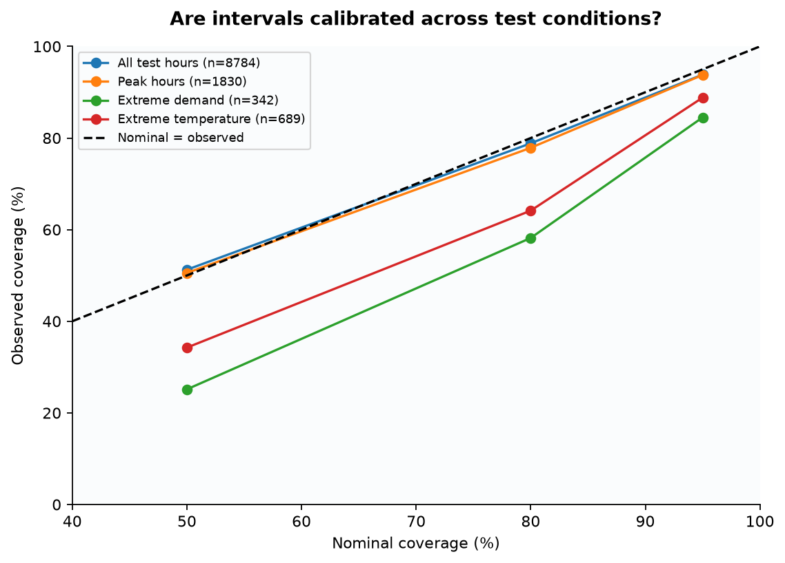
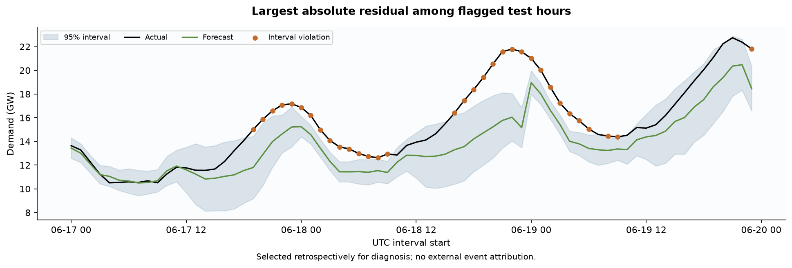

# GridCast

**How accurately can short-term electricity demand be forecast, how uncertain are those forecasts,
and when do sophisticated models outperform strong seasonal baselines?**

GridCast is a time-series study of New England electricity demand. It compares six forecasting
approaches on daily 24-hour paths, then evaluates the selected model's accuracy, prediction intervals
and unusual demand periods on a reserved test year. The emphasis is on when models fail as well as
which model has the lowest average error.

## Results

<!-- BEGIN RESULTS -->
**LightGBM had the lowest validation MAE.** On the final test, its MAE was **705.2 MW**, compared with **907.8 MW** for Daily Seasonal Naive (22.3% lower). Only the selected model and the predeclared daily baseline were evaluated on the final test.

| Model | Validation MAE (MW) | RMSE (MW) | WAPE (%) | MASE |
|---|---:|---:|---:|---:|
| LightGBM | 723.7 | 1,019.2 | 5.60 | 0.539 |
| LSTM | 751.9 | 1,043.4 | 5.82 | 0.560 |
| Daily | 924.3 | 1,288.9 | 7.15 | 0.689 |
| Harmonic | 1,008.5 | 1,283.8 | 7.80 | 0.752 |
| Weekly | 1,438.3 | 1,987.1 | 11.13 | 1.072 |
| Naive | 2,515.5 | 3,003.1 | 19.46 | 1.876 |

The ranking changes under stress: **Harmonic** had the lowest validation extreme-demand MAE (**1,415.5 MW**). The threshold is the initial-training 95th percentile, **17,971.4 MW**, held fixed for all models.

| Nominal interval | Test coverage | Mean width (MW) | Extreme-demand coverage |
|---|---:|---:|---:|
| 50% | 51.25% | 1,152.2 | 25.15% |
| 80% | 78.85% | 2,268.5 | 58.19% |
| 95% | 93.84% | 3,939.9 | 84.50% |

The test contains **541 flagged hours** in **175 contiguous UTC episodes**. The largest flagged absolute residual occurred at **2024-06-18 23:00:00+00:00**: actual minus forecast was **6,410.3 MW**. These are unusual demand observations relative to the forecast, not verified outages or grid failures.

Overall coverage conceals undercoverage during extreme demand. No test-based retuning or causal explanation of anomalies is used. Full metrics, condition slices, interval scores and the diagnostic case selection are in the linked reports.
<!-- END RESULTS -->


The daily seasonal baseline is a serious competitor. The harmonic model and weekly baseline do not
improve on it overall; the nonlinear models do, but their advantage is not uniform across conditions.
[Fold metrics](reports/tables/fold_metrics.csv) show monthly variation. The
[paired comparisons](reports/tables/paired_comparisons.csv) use daily MAE differences, seven-lag HAC
intervals and Holm-adjusted p-values. These are exploratory validation comparisons, not a correction
for selecting the best model or a claim of final-test significance.

## Data and forecasting protocol

EIA-930 provides **ISNE reported hourly demand for 2020–2024**. NOAA observations at Boston, Hartford
and Providence form an equal-weight temperature proxy; all three stations are required. Weather
supports descriptive analysis and error slices, but future observed weather never enters a predictor.
See [data quality](reports/data_quality.json), [source definitions](reports/source_definitions.json),
[transformations](reports/transformations.json) and the [source lock](configs/sources.lock.json).

Source hour-ending timestamps become **UTC interval starts**. Hourly MWh divided by one hour gives
average MW. Local calendar features use America/New_York, retaining both repeated autumn hours,
spring gaps in local time and leap days. Missing weather stays missing; demand is not imputed.
These are retrospective, potentially revised data, not an archive of what was published in real time.

| Partition | Period | Role |
|---|---|---|
| Initial training | 2020–2022 | Fit models, define extreme thresholds, exploratory analysis |
| Validation | January–September 2023 | Nine expanding monthly folds; select by overall MAE |
| Calibration | October–December 2023 | Initialize out-of-sample residual history |
| Final test | 2024 | Evaluate frozen model choices and rolling intervals |

Each forecast originates at **00:00 UTC** and predicts the next **24 hourly intervals**. A one-hour
reporting delay means the latest usable interval starts two hours before the origin. Monthly refits
use only labels already available; earlier test observations can enter later refits once reported.
The final test is thus a chronological evaluation with frozen hyperparameters, not a single static fit.


[Demand history](reports/figures/01_demand_history.png), [weather relationships](reports/figures/04_weather_relationship.png)
and [training-only findings](reports/eda_findings.md) provide the descriptive context.

## Models and leakage controls

- **Naive:** repeat the last available demand observation.
- **Daily Seasonal Naive:** use the available 24-hour lag; the final horizon falls back to 48 hours
  because its 24-hour source has not yet been reported.
- **Weekly Seasonal Naive:** use the available 168-hour lag.
- **Statistical:** harmonic regression for daily, weekly and annual cycles, calendar effects and
  feasible-GLS AR(1) errors; condition on the latest available residual.
- **LightGBM:** predict a correction to the daily baseline using available lags, rolling summaries,
  known calendar features and forecast horizon.
- **LSTM:** encode the last available week with a compact recurrent network and decode a daily-baseline
  correction using calendar and seasonal templates. It is a limited deep-learning comparison.

Learner early stopping uses a chronological inner window, purged until all training-path labels
are available. Scaling uses training inputs only. Validation determines the model and fixed tree count
before calibration/test outcomes are opened. Demand and temperature extremes are defined from initial
training only. [Origin audits](reports/tables/origin_audit.csv), [selection evidence](reports/model_selection.json),
[fit records](reports/statistical_fits.json) and future-mutation tests document these boundaries.

Metrics are MAE and RMSE in MW, WAPE in percent, and MASE scaled by the fold's training weekly-naive
absolute error. The full setup is in [evaluation.yaml](configs/evaluation.yaml); the configuration
hash remains part of the saved research provenance.

## When forecasts fail


Condition groups overlap: normal weekdays, weekends, holidays, local peak hours, extreme demand
and extreme temperatures. Missing weather has its own slice. [Hourly and seasonal errors](reports/figures/21_hour_season_errors.png)
expose patterns hidden by overall averages; validation autumn includes September only.
[Extreme-demand metrics](reports/tables/extreme_demand_metrics.csv) and
[peak-hour metrics](reports/tables/peak_hour_metrics.csv) separate validation from final-test evidence.

## Uncertainty and unusual demand

Intervals use rolling **90-day absolute forecast residuals, separately by horizon**, with rank
`ceil((n + 1) × nominal coverage)`. Only residuals with reported labels enter calibration.
Serial dependence and drift prevent an IID, distribution-free coverage guarantee. Coverage, width
and interval score are reported together; wide intervals alone are not evidence of useful uncertainty.



[Prediction intervals](reports/figures/15_prediction_intervals.png),
[width and miss penalties](reports/figures/17_interval_width_score.png),
[extreme-demand intervals](reports/figures/20_extreme_demand_intervals.png) and
[rolling reliability](reports/figures/18_rolling_reliability.png) show the remaining weaknesses.



A 95% interval violation marks unusual demand relative to the forecast. Consecutive flagged UTC
hours form an episode; episode endpoints are interval starts. Flags become knowable only when demand
is reported. The example above is selected retrospectively by largest absolute flagged residual,
not as a representative period or evidence of a physical event. See the
[monthly anomaly summary](reports/tables/anomaly_summary.csv) and [episode table](reports/tables/anomaly_episodes.csv).

## Limits

One region, a small model search and one neural training seed do not establish general superiority
of any model family. Station averages imperfectly represent a six-state grid. The study omits
operational weather forecasts and cannot reproduce historical data revisions. Extreme events are
rare, condition groups overlap, and good average accuracy coexists with tail undercoverage. There is
no external ground truth for interpreting anomalies as outages, failures or emergencies.

## Reproduce and explore

Requires **CPython 3.12**; tested on macOS arm64 (macOS 14+ for the pinned PyTorch wheel).

```bash
make setup       # Install pinned dependencies in .venv; smoke-test native runtimes
make report      # Build figures, summary tables, JSON findings and README from saved results
make data        # Fetch/verify source snapshots; validate and create processed partitions
make analysis    # Full data, EDA, backtesting, uncertainty and reporting pipeline
make backtest    # Refit the six-model validation study
make reliability # Refit frozen-model calibration/test forecasts and evaluate reliability
make test        # Offline tests, including time boundaries and future-mutation checks
make lint        # Static checks
make reproduce   # Isolated offline replay and artifact hash comparison; requires cached raw data
```

`make report` uses committed predictions and fit records: no downloads or model fitting. EDA figures
are generated by `make analysis` from the training partition. Raw source snapshots occupy about
200 MB and are ignored by Git. Keep them for exact offline replay: upstream URLs can change, and
checksum mismatches fail rather than silently adopting a new dataset. On macOS, Make configures
LightGBM and PyTorch to share one OpenMP runtime; use Make for fitting and tests.

The [machine-readable results](reports/results/summary.json) record input hashes and unrounded metrics.
[Detailed validation findings](reports/baseline_findings.md), [reliability findings](reports/reliability_findings.md)
and three notebooks provide deeper views:
[EDA](notebooks/01_eda.ipynb), [forecasting](notebooks/02_forecasting.ipynb),
[uncertainty and anomalies](notebooks/03_uncertainty_anomalies.ipynb).
The [replay audit](reports/reproducibility.json) records its exact runtime; bitwise equality is not
promised across operating systems.

The repository separates `configs/`, reusable analysis in `src/gridcast/`, `tests/`, chronological
`data/` partitions, `notebooks/`, and generated `reports/figures`, `reports/tables`, `reports/results`.
Saved predictions and model artifacts support auditing; raw/intermediate data and scratch work stay untracked.

**Milestones 1–5 complete:** Data → Baselines + Backtesting → Machine Learning → Uncertainty + Anomalies
→ Analysis + Reporting. **Milestone 6: Final Audit** remains next. Each milestone is committed and pushed to GitHub.
